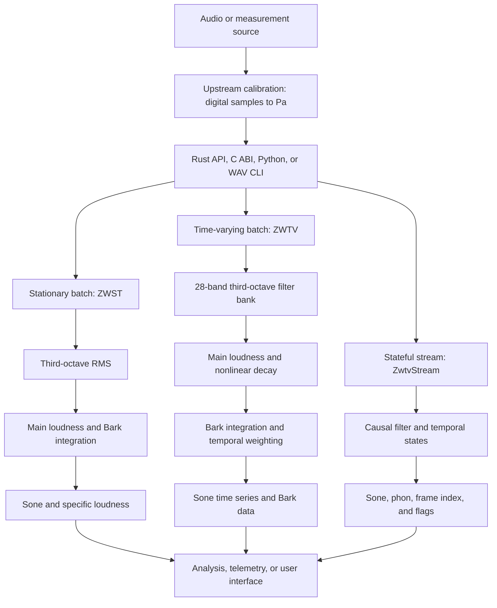

# soneflow

**Real-time streaming psychoacoustic engine**

[繁體中文](README.zh-TW.md) | English

An AI-assisted Rust engine for ISO 532-1:2017 Zwicker loudness, built to add a perceptual-loudness view alongside dBFS, LUFS, and dB SPL monitoring.


## Why this project exists

I am an infrastructure engineer, not a professional acoustics or DSP software engineer. This project began as a practical attempt to help churches understand current listening conditions more easily: conventional meters such as dBFS, LUFS, and dB SPL remain essential, but they do not by themselves express perceived loudness in **sone**, **phon**, or **specific loudness over Bark**.

The engine was developed through human-directed AI collaboration, test-first iteration, reference comparison, and repeated code review. AI assistance does not make the implementation authoritative. Acoustic researchers, DSP engineers, Rust/C/Python maintainers, measurement specialists, live-sound engineers, and other reviewers are warmly invited to inspect the assumptions, reproduce the evidence, identify mistakes, and help improve the project.

## What it provides

- ISO 532-1 stationary loudness (`loudness_zwst`)
- ISO 532-1 time-varying loudness (`loudness_zwtv`)
- Total loudness in **sone** and specific loudness in **sone/Bark**
- Sone-to-phon conversion
- A stateful 48 kHz streaming path with a 2 ms output grid
- Automatic AVX2+FMA dispatch on supported x86-64 CPUs, with a scalar fallback
- Rust, C ABI, and Python interfaces
- A small calibrated-WAV CLI example
- API, SIMD, determinism, C ABI and Python checks, with MoSQITo 1.2.1 used as a compatibility baseline

The engine consumes **calibrated acoustic pressure samples in pascals**, not raw dBFS values. It complements dBFS/LUFS/dB SPL monitoring; it does not replace those meters.

## Current boundaries

- Input sample rate is exactly **48,000 Hz**. Resampling belongs upstream.
- Input calibration from digital full scale to pascals is the integrator's responsibility.
- The Rust streaming hot path is tested for no allocation after construction and does not initialize Rayon; Python `push()` necessarily allocates NumPy outputs.
- The stream has 24 input samples of algorithmic latency and marks the first 580 output frames as warm-up.
- Batch ZWTV uses Rayon for throughput. Do not treat batch benchmarks as audio-callback deadline evidence.
- This repository does not provide a finished VST/DAW plug-in or observability dashboard.
- ARM uses the scalar path; no NEON kernel is implemented.
- Only ISO 532-1 loudness is implemented. Sharpness, roughness, tonality, and other standards are outside this implementation.

## Architecture



The stationary front end intentionally follows the MoSQITo-compatible spectrum path. The time-varying path uses a third-octave filter bank, nonlinear decay, Bark integration, and temporal weighting. Scalar, AVX2, Rayon, binding, and streaming variants share the same core equations and are guarded by parity tests.

## Repository and data structures

```text
soneflow/
|-- soneflow/                Rust core, examples, integration tests, benchmarks
|   |-- src/dsp/             filters and reusable DSP primitives
|   |-- src/core/            main-loudness and Bark-slope equations
|   |-- src/zwst/            stationary orchestration
|   `-- src/zwtv/            batch and stateful streaming orchestration
|-- soneflow-ffi/            C ABI crate and generated public header
|-- soneflow-py/             PyO3/NumPy binding and Python tests
|-- tools/                   development, comparison, and benchmark tools
|-- docs/                    design documents and project policies
|-- Cargo.toml               workspace manifest
`-- Cargo.lock               frozen Rust dependency graph
```

The public numeric data contract is:

| Path | Input | Output |
|---|---|---|
| ZWST batch | One-dimensional 48 kHz `f64`/`float64` pressure samples in Pa, plus `free` or `diffuse` field | Total `N: f64` in sone, `N_specific[240]` in sone/Bark, and `bark[240]` |
| ZWTV batch | Same pressure array and field | `N[frames]`, `N_specific[240, frames]` (Bark-major), `bark[240]`, and exact 2 ms `time[frames]` |
| Stream | Consecutive chunks of calibrated 48 kHz pressure samples | Zero or more frames containing sone, phon, frame index, and status flags; `flush()` returns the tail |
| C ABI | Caller-owned input and output pointers with explicit lengths | The same layouts flattened into caller-owned buffers; see `soneflow-ffi/include/soneflow.h` |

Output grid: for an input of `L` samples, ZWTV batch and stream produce `ceil(ceil(L/24)/4)` points (`zwtv_out_frames`, this library's C ABI `snf_zwtv_out_frames`). Point `j` lies at `96j/48000` seconds, beginning at zero. A point depends only on samples up to its timestamp, preserving prefix causality.

## Quick start

Before using the engine, confirm that the input is 48 kHz, mono, contiguous `float64` pressure data in pascals. Do not pass normalized digital samples unless you have applied a traceable sample-to-pascal calibration. Choose `"free"` or `"diffuse"` to match the measurement setup; the library cannot infer the field condition.

### Rust

Build from the repository root:

```powershell
cargo build --release
```

Stationary loudness:

```rust
use soneflow::{loudness_zwst, FieldType};

fn main() -> Result<(), soneflow::SoneflowError> {
    // Replace this with calibrated 48 kHz pressure samples in Pa.
    let pressure_pa = vec![0.0_f64; 48_000];
    let result = loudness_zwst(&pressure_pa, 48_000.0, FieldType::Free)?;
    println!("{:.3} sone", result.n);
    Ok(())
}
```

Time-varying loudness:

```rust
use soneflow::{loudness_zwtv, FieldType};

fn analyze(pressure_pa: &[f64]) -> Result<(), soneflow::SoneflowError> {
    let result = loudness_zwtv(pressure_pa, 48_000.0, FieldType::Free)?;
    println!("{} frames on a 2 ms grid", result.n.len());
    Ok(())
}
```

### Python

Build the local extension with Maturin:

```powershell
py -3.11 -m venv .venv
.venv\Scripts\python.exe -m pip install maturin numpy
.venv\Scripts\maturin.exe develop --release -m soneflow-py\Cargo.toml
```

Batch API:

```python
import numpy as np
import soneflow

pressure_pa = np.zeros(48_000, dtype=np.float64)  # calibrated Pa, contiguous
n, n_specific, bark, time_s = soneflow.loudness_zwtv(
    pressure_pa, 48_000.0, "free"
)
```

Streaming API:

```python
stream = soneflow.ZwtvStream("free")
n, n_phon, frame_index, flags = stream.push(pressure_pa[:480])
tail = stream.flush()
```

The Python input contract is contiguous `float64`. Batch functions (`loudness_zwst`, `loudness_zwtv`) reject a NaN or infinite sample with `ValueError` (core error `NonFiniteInput`, C ABI code `SNF_ERR_NONFINITE_INPUT` = 4) and write nothing; the stream zeroes the sample and reports it through the `NONFINITE_INPUT` flag because it must never fail on the audio thread. The two semantics are deliberately different.

### This library's C ABI

Build the shared library and include the generated header:

```powershell
cargo build -p soneflow-ffi --release
```

The stable v1 declarations and buffer contracts are in [`soneflow-ffi/include/soneflow.h`](soneflow-ffi/include/soneflow.h). The API includes:

- `snf_loudness_zwst`
- `snf_loudness_zwtv`
- `snf_stream_new` / `snf_stream_push` / `snf_stream_flush` / `snf_stream_free`

Callers own all batch output buffers. A stream handle is single-threaded and must not be called concurrently.

### WAV CLI example

```powershell
cargo run -p soneflow --example cli -- path\to\mono-48k.wav --calib 0.632455532
```

`--calib` is a linear multiplier from normalized WAV samples to pascals. It is **not** a dB value. The example downmixes multichannel WAV input to mono and currently computes stationary, free-field loudness.

## Integration guide

| Consumer | Recommended interface | Notes |
|---|---|---|
| Rust service or offline analyzer | `soneflow` crate | Batch ZWST/ZWTV or `ZwtvStream` |
| C, C++, Go, .NET, or another FFI host | `soneflow-ffi` | Caller-owned buffers; frozen C ABI v1 |
| Python analysis, notebooks, validation | `soneflow-py` | NumPy batch and streaming APIs; GIL released during core batch work |
| Shell/WAV check | `examples/cli.rs` | Demonstration only; calibration must be supplied |
| Prometheus/telemetry service | Rust stream or C stream | Export sone, phon, flags, and frame index; aggregate before high-cardinality export |
| Monitoring user interface | Rust or C stream API | Keep dBFS, LUFS, and dB SPL visible beside sone/phon; aggregate frames before display |

A safe panel pipeline is:

```text
audio interface -> known gain/sensitivity calibration -> pressure Pa at 48 kHz
                -> soneflow stream -> sone/phon/flags -> time aggregation -> dashboard
```

Do not infer pascals from dBFS without a traceable microphone/interface calibration. Wrong calibration shifts every loudness result. Also avoid presenting sone or phon as a hearing-safety or legal-compliance measurement unless the complete measurement chain has been independently validated for that purpose.

## Performance measurement

Batch throughput and streaming callback latency answer different questions. Measure each on the target CPU with the intended channel count and chunk size. Record build settings, SIMD dispatch, thread count, warm-up and the exact source snapshot.

```powershell
cargo bench -p soneflow --bench loudness
cargo bench -p soneflow --features internals --bench core -- filter_bank
.venv\Scripts\python.exe tools\compare_mosqito.py
```

The comparison tool measures the configured local Rust/Python environment. Interleave runs when comparing versions, and report their distributions and numerical differences together. Performance results must identify the version and environment actually measured.

## Measured results (0.1.0)

Measured on 2026-11-24 from source `6d48bf1` (the product code of 0.1.0, measured before the project was renamed to soneflow; the rename changed no computation): Windows 10 (build 19045), AMD Zen 2 CPU (family 23 model 113, 12 logical CPUs), rustc 1.99.1, Python 3.11.9, NumPy 2.4.6, MoSQITo 1.2.1. Other machines will give other timings; the commands to reproduce are listed below the tables.

### Speed

| Measurement | Result |
|---|---|
| ZWTV, 3 s test signal, Python binding vs MoSQITo 1.2.1 (30 runs each, after one warm-up) | soneflow 8.10 ms (sd 0.39 ms), MoSQITo 6.587 s (sd 0.025 s): about 810x faster; 370x real time vs 0.46x |
| ZWTV, 10 s signal, Rust batch, 12 threads | scalar 41.9 ms, AVX2 30.1 ms |
| ZWTV, 10 s signal, Rust batch, 1 thread (`RAYON_NUM_THREADS=1`) | scalar 192.0 ms, AVX2 100.1 ms |
| Third-octave filter bank, 10 s signal, 12 threads | scalar 14.4 ms, AVX2 5.57 ms |
| Stream, 10 s signal pushed in 480-sample (10 ms) chunks, one thread | scalar 184.2 ms, AVX2 83.1 ms (about 83 µs per 10 ms chunk on average) |

Rust timings are Criterion medians. Batch throughput is not callback latency; measure the stream on the target host before relying on it in an audio callback.

### ISO 532-1 Annex B

The test suite includes checks against ISO 532-1 Annex B. The Annex B test signals and reference values are licensed with the standard, so those checks run only with your own licensed copy (see "Verification scope"); their results are not published here.

### Agreement with MoSQITo 1.2.1

| Path and fixtures | Total loudness | Specific loudness |
|---|---|---|
| ZWST, 4 synthetic fixtures (sines, white noise) | max 4.7e-4 sone (relative max 6.2e-5) | max 1.5e-4 sone/Bark |
| ZWTV, 3 synthetic fixtures (sine, tone pulse, 60→80 dB step), same initial state as MoSQITo (`nl_init="mosqito_tail"`) | max 1.7e-4 sone, except 3.9e-3 on the step | max 2.2e-2 sone/Bark |
| ZWTV, 3 s test signal, default zero state, Python binding | 5.8e-3 sone | 3.2e-2 sone/Bark |

The specific-loudness differences are expected: where a slope ends inside a 0.1 Bark cell, this crate writes the core loudness and MoSQITo extrapolates the slope. With the default zero initial state the first part of a signal differs further (on the step fixture up to 5.6e-2 sone), because MoSQITo seeds the nonlinear decay from the last frame of the signal. The three loudness tables `ZUP`, `RNS` and `USL` are identical to MoSQITo's (`tools/compare_mosqito.py --check-tables`).

### Reproduce

```powershell
cargo bench -p soneflow --bench loudness
$env:RAYON_NUM_THREADS = 1; cargo bench -p soneflow --bench loudness -- zwtv_10s
cargo bench -p soneflow --features internals --bench core -- filter_bank
.venv\Scripts\python.exe tools\compare_mosqito.py --iterations 30
.venv\Scripts\python.exe tools\compare_mosqito.py --iterations 5 --nl-init mosqito_tail
.venv\Scripts\python.exe tools\compare_mosqito.py --check-tables
cargo test --release --features internals --test golden_zwst --test golden_zwtv -- --nocapture
```

The MoSQITo golden tests need `data/` (see [`docs/GOLDEN-REGEN-SOP.md`](docs/GOLDEN-REGEN-SOP.md)). The numbers above come from the synthetic fixtures only.

## Verification scope

API checks use known inputs to examine output shapes, the time and Bark axes, input validation, state reset and chunk handling. Comparisons between Rust, the C ABI and Python check that each interface exposes the intended contract. Numerical comparisons should record input construction, calibration, initialization mode, platform and the tested source version.

Synthetic-input checks cover specific behaviors; they do not establish every test's prerequisites or complete ISO 532-1 conformance. This overview does not claim that the full test suite runs without external data. A skipped check must be reported as skipped.

MoSQITo 1.2.1 is a separate compatibility baseline. Report the settings and the quantity being compared, rather than treating a matching number as proof of all library behavior.

The ISO 532-1 Annex B test signals and reference values are licensed with the standard and are not part of this repository. To run the Annex B tests, copy the files listed under `annexb/` in [`tools/golden.sha256`](tools/golden.sha256) from your own licensed copy into `data/annexb/`, then check them with `python tools/golden_manifest.py --verify`. CI does not run these tests.

## Acknowledgements and citation

This project gratefully acknowledges **MoSQITo**, its maintainers, contributors, Eomys, and the organizations that have continued the project. MoSQITo provided an accessible, documented, validated, and reproducible reference implementation that informed this native Rust implementation and its comparisons. The reference baseline used here is MoSQITo 1.2.1.

- [MoSQITo repository](https://github.com/Eomys/MoSQITo)
- [MoSQITo documentation](https://mosqito.readthedocs.io/en/latest/)
- [MoSQITo time-varying Zwicker loudness API](https://mosqito.readthedocs.io/en/latest/source/reference/mosqito.sq_metrics.loudness.loudness_zwtv.loudness_zwtv.html)
- Green Forge Coop. *MOSQITO* (software). [https://doi.org/10.5281/zenodo.10629475](https://doi.org/10.5281/zenodo.10629475)
- R. San Millán-Castillo et al., “MOSQITO: an open-source and free toolbox for sound quality metrics in the industry and education,” INTER-NOISE 2021. [https://doi.org/10.3397/IN-2021-1767](https://doi.org/10.3397/IN-2021-1767)
- [ISO 532-1:2017 catalogue entry](https://www.iso.org/standard/63077.html)

Please cite MoSQITo in research or derived validation work according to its documentation and repository citation metadata. soneflow is not affiliated with or endorsed by the MoSQITo project.

## Contributing and expert review

Constructive review is especially welcome in these areas:

- Loudness-model interpretation and reproducible API checks
- Filter design, state initialization, numerical analysis, and SIMD equivalence
- Acoustic calibration from microphones/interfaces to pascals
- Real-time callback P99/P99.9 behavior, denormals, and host integration
- C ABI, Python wheels, portability, and ARM/NEON work
- Accessible visualization of sone, phon, Bark distributions, warm-up, and measurement confidence
- Church/live-sound operating practices and user comprehension

When reporting a result, please include the input provenance, calibration chain, sample rate, field type, CPU/OS, exact commit, and the command used. A disagreement backed by a reproducible fixture is more valuable than a reassuring but untestable claim.

Before contributing, read [CONTRIBUTING.md](CONTRIBUTING.md) and the
[Code of Conduct](CODE_OF_CONDUCT.md). Security-sensitive reports belong in the
private path described by [SECURITY.md](SECURITY.md).

## License

This repository is licensed under [Apache License 2.0](LICENSE). Third-party names, publications, standards, test data, and software remain subject to their respective rights and licenses.
