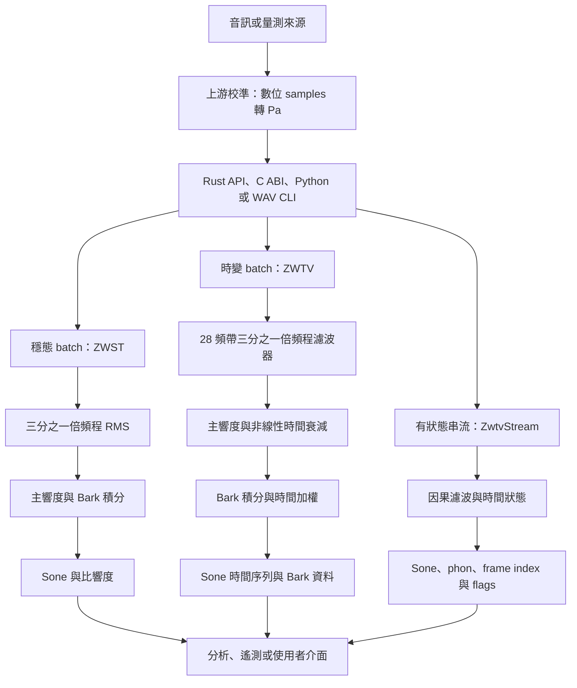

# soneflow

**即時串流心理聲學引擎**

繁體中文 | [English](README.md)

這是一個以 AI 協作開發的 ISO 532-1:2017 Zwicker 響度 Rust 引擎，希望在 dBFS、LUFS 與 dB SPL 之外，增加一個描述聽感響度的可觀測面向。


## 為什麼製作這個專案

我是一名 infra 工程師，不是專業聲學、DSP 或底層軟體工程師。製作這個引擎的起點很單純：希望幫助教會在既有 dBFS、LUFS、dB SPL 儀表之外，用更容易理解的方式觀察目前的聽感狀況，例如 **sone**、**phon**，以及 Bark 頻帶上的**比響度**。

本專案由人主導需求、判斷與驗證，並透過 AI 協作、測試優先、參照實作比對及多輪程式碼審查完成。使用 AI 不代表結果天然正確，也不代表這套實作具有權威性。誠摯邀請聲學研究者、DSP 工程師、Rust／C／Python 開發者、量測專家、現場音響工程師與各路先進，一起檢查假設、重現證據、指出錯誤並協助完善。

## 目前提供的能力

- ISO 532-1 穩態響度（`loudness_zwst`）
- ISO 532-1 時變響度（`loudness_zwtv`）
- 總響度 **sone** 與比響度 **sone/Bark**
- sone 轉 phon
- 48 kHz、有狀態、2 ms 輸出網格的串流處理
- 支援的 x86-64 CPU 自動使用 AVX2+FMA，否則回退 scalar
- Rust、C ABI 與 Python 介面
- 一個已校準 WAV 的簡易 CLI 範例
- API、SIMD、確定性、C ABI 與 Python 檢查，並以 MoSQITo 1.2.1 作為相容性基準

引擎輸入是**已校準、單位為 Pa 的聲壓取樣**，不是原始 dBFS。它用來補充 dBFS／LUFS／dB SPL 的觀測面，不是取代這些儀表。

## 現階段限制

- 輸入取樣率必須恰為 **48,000 Hz**；重採樣應在上游完成。
- 數位 full scale 到 Pa 的校準由整合端負責。
- Rust 串流熱路徑在建立後通過零配置測試且不初始化 Rayon；Python `push()` 仍會配置 NumPy 輸出。
- 串流演算法延遲為 24 個輸入 samples，前 580 個輸出 frames 會標記為 warm-up。
- Batch ZWTV 使用 Rayon 增加吞吐量；batch benchmark 不能直接當作 audio callback deadline 證據。
- 本 repo 尚未提供完成的 VST／DAW plugin 或可觀測面板。
- ARM 目前使用 scalar，尚無 NEON kernel。
- 目前僅實作 ISO 532-1 響度；sharpness、roughness、tonality 及其他標準尚未納入。

## 架構圖



穩態前端刻意維持與 MoSQITo 相容的頻譜路徑；時變路徑則包含 1/3 倍頻程濾波、非線性衰減、Bark 積分與時間加權。Scalar、AVX2、Rayon、binding 與 streaming 版本共用同一套核心方程，並以 parity tests 看守。

## Repo 與資料結構

```text
soneflow/
|-- soneflow/                Rust core、examples、integration tests、benchmarks
|   |-- src/dsp/             filters 與可重用 DSP primitives
|   |-- src/core/            主響度與 Bark slope 方程
|   |-- src/zwst/            穩態流程編排
|   `-- src/zwtv/            batch 與有狀態 streaming 流程
|-- soneflow-ffi/            C ABI crate 與產生完成的 public header
|-- soneflow-py/             PyO3/NumPy binding 與 Python tests
|-- tools/                   開發、比較及 benchmark 工具
|-- docs/                    設計文件與專案政策
|-- Cargo.toml               workspace manifest
`-- Cargo.lock               固定的 Rust dependency graph
```

公開數值 API 的資料契約如下：

| 路徑 | 輸入 | 輸出 |
|---|---|---|
| ZWST batch | 一維 48 kHz `f64`／`float64` Pa 聲壓 samples，加上 `free` 或 `diffuse` 聲場 | sone 單位的總響度 `N: f64`、`N_specific[240]` sone/Bark，以及 `bark[240]` |
| ZWTV batch | 相同的聲壓陣列與聲場 | `N[frames]`、Bark-major 的 `N_specific[240, frames]`、`bark[240]`，以及精確 2 ms 的 `time[frames]` |
| Stream | 依時間順序輸入的已校準 48 kHz chunks | 零或多筆包含 sone、phon、frame index、status flags 的 frames；`flush()` 取回尾端 |
| C ABI | Caller-owned input/output pointers 與明確 lengths | 相同 layout 攤平成 caller-owned buffers；詳見 `soneflow-ffi/include/soneflow.h` |

輸出格線：長度為 `L` 個 samples 的輸入，ZWTV batch 與 stream 產生 `ceil(ceil(L/24)/4)` 個點（`zwtv_out_frames`、本函式庫 C ABI 的 `snf_zwtv_out_frames`）。第 `j` 點位於 `96j/48000` 秒，從零開始；每點只取決於不晚於其時間點的樣本，保留前綴因果性。

## 快速使用

使用前請先確認輸入為 48 kHz、mono、contiguous `float64`，且數值是單位為 Pa 的已校準聲壓。除非已有可追溯的 sample-to-Pa 校準，否則不要直接傳入 normalized digital samples。`"free"`／`"diffuse"` 必須依量測配置選擇，library 無法自行判斷聲場條件。

### Rust

在 repo 根目錄建置：

```powershell
cargo build --release
```

穩態響度：

```rust
use soneflow::{loudness_zwst, FieldType};

fn main() -> Result<(), soneflow::SoneflowError> {
    // 請換成已校準、48 kHz、單位 Pa 的聲壓 samples。
    let pressure_pa = vec![0.0_f64; 48_000];
    let result = loudness_zwst(&pressure_pa, 48_000.0, FieldType::Free)?;
    println!("{:.3} sone", result.n);
    Ok(())
}
```

時變響度：

```rust
use soneflow::{loudness_zwtv, FieldType};

fn analyze(pressure_pa: &[f64]) -> Result<(), soneflow::SoneflowError> {
    let result = loudness_zwtv(pressure_pa, 48_000.0, FieldType::Free)?;
    println!("2 ms 網格上共有 {} frames", result.n.len());
    Ok(())
}
```

### Python

使用 Maturin 建立本機 extension：

```powershell
py -3.11 -m venv .venv
.venv\Scripts\python.exe -m pip install maturin numpy
.venv\Scripts\maturin.exe develop --release -m soneflow-py\Cargo.toml
```

Batch API：

```python
import numpy as np
import soneflow

pressure_pa = np.zeros(48_000, dtype=np.float64)  # 已校準 Pa，且 contiguous
n, n_specific, bark, time_s = soneflow.loudness_zwtv(
    pressure_pa, 48_000.0, "free"
)
```

Streaming API：

```python
stream = soneflow.ZwtvStream("free")
n, n_phon, frame_index, flags = stream.push(pressure_pa[:480])
tail = stream.flush()
```

Python 輸入契約為 contiguous `float64`。批次函式（`loudness_zwst`、`loudness_zwtv`）遇到 NaN 或無限大 sample 會拒絕並丟出 `ValueError`（核心錯誤 `NonFiniteInput`，C ABI 錯誤碼 `SNF_ERR_NONFINITE_INPUT` = 4），不寫任何輸出；串流則將該 sample 歸零並以 `NONFINITE_INPUT` flag 回報，因為音訊執行緒上不能失敗。兩種語意是刻意分開設計的。

### 本函式庫的 C ABI

建置 shared library，並使用產生完成的 header：

```powershell
cargo build -p soneflow-ffi --release
```

穩定的 v1 宣告與 buffer 契約位於 [`soneflow-ffi/include/soneflow.h`](soneflow-ffi/include/soneflow.h)，主要 API 包含：

- `snf_loudness_zwst`
- `snf_loudness_zwtv`
- `snf_stream_new` / `snf_stream_push` / `snf_stream_flush` / `snf_stream_free`

Batch 輸出 buffers 全部由 caller 配置；stream handle 是單執行緒物件，不可被多執行緒同時呼叫。

### WAV CLI 範例

```powershell
cargo run -p soneflow --example cli -- path\to\mono-48k.wav --calib 0.632455532
```

`--calib` 是「正規化 WAV sample 轉換成 Pa」的線性倍率，**不是 dB 數值**。範例會把多聲道 WAV downmix 成 mono，目前只計算自由場穩態響度。

## 對接工具

| 使用情境 | 建議介面 | 注意事項 |
|---|---|---|
| Rust service 或離線分析器 | `soneflow` crate | 可用 batch ZWST／ZWTV 或 `ZwtvStream` |
| C、C++、Go、.NET 或其他 FFI host | `soneflow-ffi` | caller-owned buffers；C ABI v1 已凍結 |
| Python 分析、notebook、驗證 | `soneflow-py` | NumPy batch／stream；核心 batch 計算期間會釋放 GIL |
| Shell／WAV 快速檢查 | `examples/cli.rs` | 僅供示範，必須提供校準倍率 |
| Prometheus／遙測服務 | Rust stream 或 C stream | 可匯出 sone、phon、flags、frame index；高 cardinality 前先聚合 |
| 監測使用者介面 | Rust 或 C stream API | sone／phon 應與 dBFS、LUFS、dB SPL 並列；顯示前先做時間聚合 |

建議的面板資料流：

```text
音訊介面 -> 已知 gain／麥克風靈敏度校準 -> 48 kHz 聲壓 Pa
         -> soneflow stream -> sone／phon／flags -> 時間聚合 -> dashboard
```

沒有可追溯的麥克風／介面校準時，不可直接由 dBFS 猜測 Pa；校準錯誤會讓所有響度結果產生系統性偏移。若整條量測鏈尚未由專業單位獨立驗證，也不應把 sone 或 phon 包裝成聽力安全或法規合規判定。

## 效能量測

批次吞吐量與串流 callback 延遲回答不同問題。請在目標 CPU 上，以預期的聲道數與區塊大小分別量測，並記錄建置設定、SIMD 分派、執行緒數、暖機方式及確切來源快照。

```powershell
cargo bench -p soneflow --bench loudness
cargo bench -p soneflow --features internals --bench core -- filter_bank
.venv\Scripts\python.exe tools\compare_mosqito.py
```

比較工具量測目前設定的本機 Rust／Python 環境。比較版本時應交錯執行，並一併回報分布與數值差異。效能結果須對應實際受測的版本與環境。

## 實測結果（0.1.0）

2026-11-24 以原始碼 `6d48bf1`（0.1.0 的產品程式碼，量測時專案尚未改名為 soneflow；改名沒有改動任何計算）量測：Windows 10（build 19045）、AMD Zen 2 CPU（family 23 model 113，12 個邏輯核心）、rustc 1.99.1、Python 3.11.9、NumPy 2.4.6、MoSQITo 1.2.1。換一台機器時間會不同；重現指令列在表格下方。

### 速度

| 量測 | 結果 |
|---|---|
| ZWTV，3 秒測試訊號，Python binding 對 MoSQITo 1.2.1（各 30 次，先暖機一次） | soneflow 8.10 ms（標準差 0.39 ms），MoSQITo 6.587 s（標準差 0.025 s）：約快 810 倍；即時倍率 370 倍對 0.46 倍 |
| ZWTV，10 秒訊號，Rust 批次，12 執行緒 | scalar 41.9 ms，AVX2 30.1 ms |
| ZWTV，10 秒訊號，Rust 批次，單執行緒（`RAYON_NUM_THREADS=1`） | scalar 192.0 ms，AVX2 100.1 ms |
| 三分之一倍頻程濾波器組，10 秒訊號，12 執行緒 | scalar 14.4 ms，AVX2 5.57 ms |
| 串流，10 秒訊號以 480 樣本（10 ms）一塊推入，單執行緒 | scalar 184.2 ms，AVX2 83.1 ms（平均每 10 ms 區塊約 83 µs） |

Rust 的時間是 Criterion 中位數。批次吞吐量不等於 callback 延遲；要放進音訊 callback 前，請在目標主機上量串流。

### ISO 532-1 Annex B

測試裡有對照 ISO 532-1 Annex B 的檢查。Annex B 的測試訊號與參考值隨標準授權，所以這些檢查只能用你自己取得授權的副本執行（見「驗證範圍」），結果不在這裡公布。

### 與 MoSQITo 1.2.1 的一致性

| 路徑與 fixture | 總響度 | 比響度 |
|---|---|---|
| ZWST，4 個合成 fixture（正弦、白雜訊） | 最大 4.7e-4 sone（相對最大 6.2e-5） | 最大 1.5e-4 sone/Bark |
| ZWTV，3 個合成 fixture（正弦、音調脈衝、60→80 dB 階躍），初始狀態與 MoSQITo 相同（`nl_init="mosqito_tail"`） | 最大 1.7e-4 sone，階躍例外，為 3.9e-3 | 最大 2.2e-2 sone/Bark |
| ZWTV，3 秒測試訊號，預設零狀態，Python binding | 5.8e-3 sone | 3.2e-2 sone/Bark |

比響度的差異是預期的：斜率在 0.1 Bark 格內結束時，本 crate 寫入主響度，MoSQITo 則延伸斜率。用預設的零初始狀態時，訊號開頭的差異會更大（階躍 fixture 最多 5.6e-2 sone），因為 MoSQITo 用訊號最後一幀當非線性衰減的初值。三個響度表 `ZUP`、`RNS`、`USL` 與 MoSQITo 完全相同（`tools/compare_mosqito.py --check-tables`）。

### 重現

```powershell
cargo bench -p soneflow --bench loudness
$env:RAYON_NUM_THREADS = 1; cargo bench -p soneflow --bench loudness -- zwtv_10s
cargo bench -p soneflow --features internals --bench core -- filter_bank
.venv\Scripts\python.exe tools\compare_mosqito.py --iterations 30
.venv\Scripts\python.exe tools\compare_mosqito.py --iterations 5 --nl-init mosqito_tail
.venv\Scripts\python.exe tools\compare_mosqito.py --check-tables
cargo test --release --features internals --test golden_zwst --test golden_zwtv -- --nocapture
```

MoSQITo golden 測試需要 `data/`（見 [`docs/GOLDEN-REGEN-SOP.md`](docs/GOLDEN-REGEN-SOP.md)）。上面的數字只來自合成 fixture。

## 驗證範圍

API 檢查以已知輸入檢查輸出形狀、時間軸與 Bark 軸、輸入驗證、狀態重設及區塊處理。Rust、C ABI 與 Python 之間的比對，檢查各介面是否提供預期的資料契約。數值比較應記錄輸入如何構造、校準、初始化模式、平台與受測來源版本。

合成輸入檢查涵蓋特定行為，不代表已確立每項測試的先決條件，也不代表完整符合 ISO 532-1。本概述不宣稱完整測試套件能在沒有外部資料時執行；略過的檢查必須明列為略過。

MoSQITo 1.2.1 是另行使用的相容性基準。比較時應交代設定與比對的量，不能由單一數值吻合推論全部函式庫行為。

ISO 532-1 Annex B 的測試訊號與參考值隨標準授權，不在本 repo 裡。要跑 Annex B 測試，請從你自己取得授權的副本，把 [`tools/golden.sha256`](tools/golden.sha256) 中 `annexb/` 底下列出的檔案複製到 `data/annexb/`，再用 `python tools/golden_manifest.py --verify` 核對雜湊。CI 不跑這些測試。

## 致謝與引用

本專案由衷感謝 **MoSQITo**、歷來維護者與貢獻者、Eomys，以及持續支持該專案的組織。MoSQITo 提供了容易取得、具文件、經驗證且可重現的參照實作，為本次原生 Rust 實作與比較提供了依據。本專案使用的參照基準版本為 MoSQITo 1.2.1。

- [MoSQITo repository](https://github.com/Eomys/MoSQITo)
- [MoSQITo 文件](https://mosqito.readthedocs.io/en/latest/)
- [MoSQITo 時變 Zwicker 響度 API](https://mosqito.readthedocs.io/en/latest/source/reference/mosqito.sq_metrics.loudness.loudness_zwtv.loudness_zwtv.html)
- Green Forge Coop. *MOSQITO*（software）。[https://doi.org/10.5281/zenodo.10629475](https://doi.org/10.5281/zenodo.10629475)
- R. San Millán-Castillo et al., “MOSQITO: an open-source and free toolbox for sound quality metrics in the industry and education,” INTER-NOISE 2021。[https://doi.org/10.3397/IN-2021-1767](https://doi.org/10.3397/IN-2021-1767)
- [ISO 532-1:2017 catalogue entry](https://www.iso.org/standard/63077.html)

研究或衍生驗證工作若使用 MoSQITo，請依其官方文件與 repository citation metadata 正確引用。本專案與 MoSQITo 無隸屬關係，也未獲其背書。

## 敬邀協作與專家審查

特別期待下列領域的具體建議：

- 響度模型解讀與可重現的 API 檢查
- 濾波器設計、狀態初始化、數值分析與 SIMD 等價性
- 麥克風／介面到 Pa 的聲學校準
- Real-time callback P99／P99.9、denormal 與 host 整合
- C ABI、Python wheels、可攜性與 ARM／NEON
- Sone、phon、Bark 分布、warm-up 與量測可信度的易懂視覺化
- 教會／現場音響的操作流程與使用者理解

回報結果時，請盡量附上輸入來源、校準鏈、取樣率、field type、CPU／OS、確切 commit 與執行命令。帶有可重現 fixture 的反例，遠比無法驗證的安心說法更有價值。

參與前請先閱讀 [CONTRIBUTING.md](CONTRIBUTING.md) 與
[Code of Conduct](CODE_OF_CONDUCT.md)。安全性問題請依
[SECURITY.md](SECURITY.md) 使用私密管道回報。

## 授權

本 repository 使用 [Apache License 2.0](LICENSE)。第三方名稱、論文、標準、測試資料與軟體仍分別受其權利與授權條款約束。
